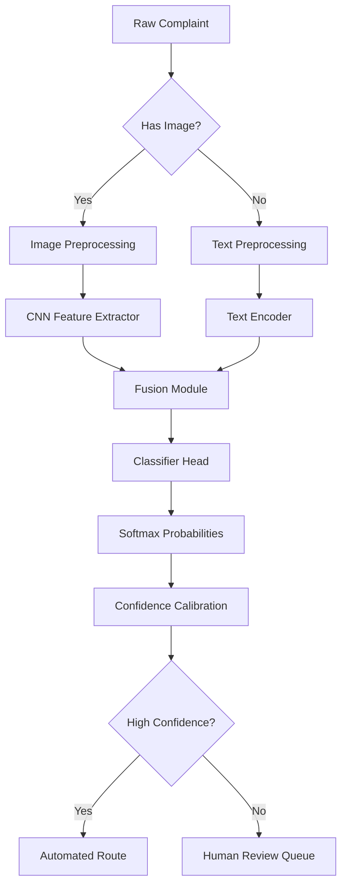

# Architecture: CampusCare ML

**Status:** Proposed Architecture (Phase 1)

## Overview

The CampusCare ML system is designed as a modular pipeline for processing student complaints, extracting features, and predicting the target department.

## 1. Machine Learning Pipeline



### Text Processing
- **Tokenization:** Subword or word-level tokenization.
- **Cleaning:** Stop-word removal, normalization, emoji handling.
- **Encoder:** Bi-LSTM with attention or Transformer encoder (scratch).

### Image Processing
- **Normalization:** Standard RGB normalization.
- **Augmentation:** Random crops, rotations for training robustness.
- **Backbone:** Small CNN (ResNet or EfficientNet variant).

### Fusion Strategy
- **Late Fusion:** Averaging or weighting probabilities from separate text and image models.
- **Early Fusion:** Concatenating feature vectors before the final classification layer.
- **Hybrid Fusion:** Cross-modal attention layers to align text and image tokens.

## 2. Inference API Architecture

The inference system is a self-hosted REST API that serves the trained models.

### API Specification
- **Endpoint:** `POST /classify`
- **Request Body:**
  ```json
  {
    "text": "string",
    "image_b64": "string (optional)"
  }
  ```
- **Response Body:**
  ```json
  {
    "prediction": "string (department name)",
    "class_id": "integer",
    "confidence": "float",
    "probabilities": {
      "Maintenance": 0.0,
      "IT": 0.0,
      "Security": 0.0,
      "Academic": 0.0,
      "Student Affairs": 0.0
    }
  }
  ```

### Technology Stack
- **Framework:** FastAPI or Flask
- **Server:** Gunicorn with Uvicorn workers
- **Runtime:** Python 3.10+
- **Model Runtime:** PyTorch
- **Containerization:** Docker

## 3. Deployment Diagram

```
┌───────────────────────────┐      ┌───────────────────────────┐
│     CampusCare App        │      │      CampusCare ML        │
│                           │      │                           │
│  ┌──────────────────┐     │      │  ┌──────────────────┐     │
│  │   Backend API    ├─────┼──────►  │   Inference API  │     │
│  └──────────────────┘     │      │  └────────┬─────────┘     │
│                           │      │           │               │
│  ┌──────────────────┐     │      │  ┌────────▼─────────┐     │
│  │   PostgreSQL     │     │      │  │   Trained Model  │     │
│  └──────────────────┘     │      │  └──────────────────┘     │
└───────────────────────────┘      └───────────────────────────┘
```

The ML service is deployed as a sidecar or standalone service reachable by the CampusCare backend. This decoupling allows independent scaling and model updates without affecting the main application.

---
**Last Updated:** 2025-11-16