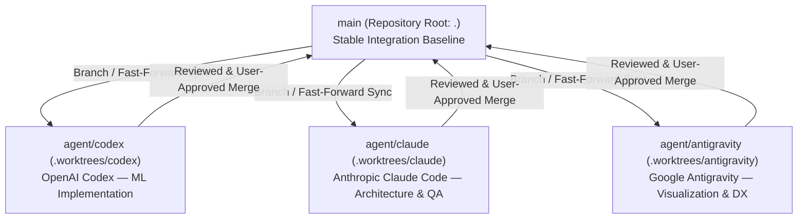

# CampusCare-ML — Multi-Agent Git Collaboration Workflow

This document defines the authoritative Git branching, worktree isolation, commit, peer review, integration, synchronization, conflict resolution, and shared documentation workflow for **CampusCare-ML**. All rules in this workflow align strictly with `AGENTS.md`.

---

## 1. Branch Architecture

CampusCare-ML uses a four-branch, four-worktree topology anchored on `main`:



| Branch | Physical Worktree Path | Owning Role | Branch Responsibilities |
|---|---|---|---|
| `main` | `.` (Repository Root) | User / Integration Baseline | Holds only reviewed, verified, and user-approved changes. Direct feature coding on `main` is prohibited. |
| `agent/codex` | `.worktrees/codex` | OpenAI Codex | Python package implementation, data validation/cleaning, feature extraction, classical & neural model training, calibration, serialization, and local inference. |
| `agent/claude` | `.worktrees/claude` | Anthropic Claude Code | System & ML architecture specifications, code quality reviews, unit/integration test suites, statistical/leakage audits, and reproducibility verification. |
| `agent/antigravity` | `.worktrees/antigravity` | Google Antigravity | Workspace/DX infrastructure, collaboration documentation, evaluation visualizations, confusion matrices, calibration plots, and approved inspection UIs. |

**Core Integration Rule:** Every feature, test suite, visualization, or specification developed on an agent branch must undergo verification and review—and receive explicit user authorization—before being integrated into `main`.

---

## 2. Working Directory Rules

To prevent file corruption, race conditions, and accidental overwrites when multiple agents operate concurrently:

1. **Strict Worktree Confinement:**
   - Every agent must execute commands and edit files strictly within its own assigned worktree during normal development:
     - **Codex** works only in `.worktrees/codex` (`agent/codex`).
     - **Claude Code** works only in `.worktrees/claude` (`agent/claude`).
     - **Antigravity** works only in `.worktrees/antigravity` (`agent/antigravity`).
2. **Cross-Worktree Modification Prohibition:**
   - **Codex** must never directly edit, stage, or delete files inside `.worktrees/claude`, `.worktrees/antigravity`, or the root `main` checkout.
   - **Claude Code** must never directly edit, stage, or delete files inside `.worktrees/codex`, `.worktrees/antigravity`, or the root `main` checkout.
   - **Antigravity** must never directly edit, stage, or delete files inside `.worktrees/codex`, `.worktrees/claude`, or the root `main` checkout without explicit user authorization.
3. **Mandatory Pre-Edit Verification:**
   - Before modifying any file, an agent must verify both its current working directory (`Get-Location` / `pwd`) and its checked-out branch (`git branch --show-current`).
4. **Exchange Changes Strictly Through Git:**
   - Agents must never copy files manually across `.worktrees/<agent>` folders. All code and documentation transfers between agents must occur through committed Git objects (`git merge`, `git cherry-pick`, or `git diff`/`git show` inspection).

---

## 3. Git Commit Policy

### 3.1 Atomic, Verified Commits
Every meaningful completed unit of work should be recorded as a focused, atomic commit after inspecting `git status` and `git diff`. Stage only files directly relevant to the active task.

### 3.2 Conventional Commit Prefixes (Beginner-Friendly Guide)

Format all commit messages as `<prefix>: <concise summary in imperative mood>`:

| Prefix | Meaning (Plain-English Explanation) | Example Commit Message |
|---|---|---|
| `feat:` | **New Feature** — Adds a new capability, module, pipeline stage, or CLI command that did not exist before. | `feat: implement training-only TF-IDF feature extractor` |
| `fix:` | **Bug Fix** — Corrects a defect, broken edge case, calculation error, or data leakage issue in existing code. | `fix: prevent vocabulary refitting on validation split` |
| `docs:` | **Documentation** — Creates or updates Markdown documentation, architecture specs, task trackers, or handoff records without changing runtime behavior. | `docs: add multi-agent task tracker and handoff protocol` |
| `test:` | **Testing** — Adds or updates automated unit tests, integration tests, or synthetic test fixtures without changing production logic. | `test: add unit tests for PII redaction and split isolation` |
| `refactor:` | **Code Restructuring** — Improves internal code structure, readability, or type annotations without changing external behavior or outputs. | `refactor: extract shared label mapping schema into core module` |
| `chore:` | **Maintenance & Infrastructure** — Updates workspace settings, `.gitignore`, build/config files, or repository maintenance items. | `chore: configure isolated agent worktrees and VS Code workspace` |

### 3.3 Prohibition on Misleading Commits
- Never commit incomplete, stubbed, or unverified code using a standard `feat:` or `fix:` message that implies the task is finished.
- Never commit `.env` files, credentials, API keys, raw private datasets, or unapproved binary artifacts.

### 3.4 Intentional Checkpoint Commits for Handoffs
When an agent must pause mid-task (for example, due to context limits or a blocker) and is authorized to save its work in Git for a receiving agent:
- Use the explicit prefix `chore(wip):` and reference the Task ID so no agent mistakes the commit for finished work:
  ```text
  chore(wip): checkpoint MODEL-002 partial TF-IDF serializer for handoff
  ```
- Immediately document what works and what remains unfinished in the corresponding `docs/handoffs/HANDOFF-<TASK-ID>-<YYYY-MM-DD>.md` file.

---

## 4. Code Review Procedure

No agent may approve its own work or automatically merge its branch into `main`. Every task follows this 9-step review workflow:

1. **Agent Finishes Assigned Task:**
   - The responsible agent completes all deliverables within the task's defined scope in its own worktree.
2. **Agent Runs Relevant Tests:**
   - The agent runs all applicable unit tests, syntax checks, or verification commands and captures the actual outputs.
3. **Agent Inspects Its Changes:**
   - The agent runs `git status` and `git diff` to verify formatting, type hints, docstrings, and the absence of unintended file modifications or scratch clutter.
4. **Agent Creates an Appropriate Commit:**
   - When authorized, the agent stages the task files and creates a conventional commit on its assigned branch (`agent/<agent>`).
5. **Agent Records Completion Evidence:**
   - The agent updates the task entry in `docs/TASK_TRACKER.md` to `In Review` (or prepares a handoff summary) with the commit hash and exact test results.
6. **Another Agent Reviews the Work:**
   - The designated reviewer (typically **Claude Code** for code/architecture/statistical reviews, or the user) inspects the branch diff (`git diff main...agent/<agent>`) against the acceptance criteria and Section 7 of `AGENTS.md`.
7. **Reviewer Reports Defects or Improvement Requests:**
   - The reviewer provides specific, actionable findings covering correctness, test coverage, potential data leakage, security/privacy, and adherence to coding standards.
8. **Original or Receiving Agent Addresses Feedback:**
   - The responsible agent resolves all reported issues in its worktree, re-runs tests, and records a follow-up commit.
9. **Approved Changes Become Eligible for Integration:**
   - Once the reviewer confirms all acceptance criteria are met, the branch is presented to the user for final approval to integrate into `main`.

---

## 5. Integration into `main`

Integrating an approved agent branch (`agent/codex`, `agent/claude`, or `agent/antigravity`) into `main` requires **explicit user authorization** and follows this checklist:

1. **Confirm User Authorization:**
   - Verify the user has explicitly approved merging the specific branch/commit into `main`.
2. **Verify Clean Integration Checkout:**
   - Inspect the root checkout (`main`) with `git status --short --branch` to ensure `main` has no uncommitted conflicting changes.
3. **Review Complete Branch Diff:**
   - Run `git log main..agent/<agent> --oneline` and `git diff main...agent/<agent>` to confirm only approved task files are included.
4. **Verify Tests and Dependencies:**
   - Confirm all required automated tests pass and no unauthorized third-party dependencies or sensitive files were added.
5. **Perform Safe Merge into `main`:**
   - When `agent/<agent>` is based directly on the current `main` HEAD, prefer a clean fast-forward merge:
     ```powershell
     git merge --ff-only agent/<agent>
     ```
   - When preserving explicit task branch topology is desired and histories are clean, use a non-fast-forward merge with a descriptive message:
     ```powershell
     git merge --no-ff agent/<agent> -m "chore: integrate <TASK-ID> from agent/<agent>"
     ```
6. **Resolve Any Integration Conflicts Safely:**
   - If a merge conflict occurs, do **not** force-merge or guess; follow Section 7 below.
7. **Update the Task Tracker:**
   - Ensure the integrated task's status in `docs/TASK_TRACKER.md` is updated to `Completed` along with the final commit hash on `main`.

---

## 6. Branch Synchronization

Because commits on `main` do not automatically propagate to `.worktrees/codex`, `.worktrees/claude`, or `.worktrees/antigravity`, agent branches must be synchronized deliberately:

### 6.1 Safe Fast-Forward Synchronization (Preferred)
When an agent's worktree is clean and has no unmerged local commits ahead of `main`:
```powershell
# Run inside .worktrees/<agent>
git status --short --branch
git merge --ff-only main
```

### 6.2 Handling Diverged Histories
If `main` has advanced while an agent branch (`agent/<agent>`) also has local commits:
1. **Never** run `git reset --hard main` or `git push --force`.
2. Inspect the divergence using:
   ```powershell
   git log --oneline --left-right main...agent/<agent>
   ```
3. If there are no overlapping file edits, request user approval to merge `main` into the agent branch (`git merge main`).
4. If both `main` and `agent/<agent>` modified the same files, follow the Conflict Resolution policy in Section 7.

---

## 7. Conflict Resolution Policy

When technical, architectural, or Git conflicts arise across the multi-agent workspace, agents must follow these rules instead of performing destructive operations:

### 7.1 Two Agents Modifying the Same File
- **Prevention:** `docs/TASK_TRACKER.md` assigns each module or document to a single primary owner per task.
- **Resolution:** If two branches touch the same file, inspect both diffs (`git diff main...agent/codex -- <file>` and `git diff main...agent/claude -- <file>`). Integrate the foundational branch into `main` first (with user approval), then carefully merge `main` into the second branch and verify all tests pass.

### 7.2 Conflicting Architectural Decisions
- Resolve strictly using the 6-level authority hierarchy in Section 9 of `AGENTS.md`:
  1. Explicit User Instructions
  2. Approved Project Specifications
  3. Shared Development Policies (`AGENTS.md`)
  4. Approved Architecture Decisions
  5. Assigned Task Requirements
  6. Individual Agent Recommendations
- If ambiguity remains, stop and escalate to the user.

### 7.3 Git Merge Conflicts
- If `git merge` reports a conflict:
  1. Do **not** commit conflict markers (`<<<<<<<`, `=======`, `>>>>>>>`).
  2. If the conflict is non-trivial or affects another agent's logic, abort the merge safely (`git merge --abort`), document the conflicting file ranges, and escalate to the user.

### 7.4 Outdated Agent Branches
- Before starting any new task (`Ready` -> `In Progress`), the assigned agent must check whether its branch is behind `main` (`git rev-list --left-right --count main...HEAD`).
- If behind `main`, synchronize with `main` (per Section 6) before writing new code or documentation.

### 7.5 Incomplete Task Handoffs
- If an agent encounters an incomplete handoff or missing context from a prior session, follow the **8-Step Emergency Handoff Workflow** in `docs/handoffs/README.md`. Never delete or reset uncommitted work in another agent's worktree.

---

## 8. Shared Documentation Policy

Shared governance documents—specifically `AGENTS.md`, `docs/TASK_TRACKER.md`, `docs/GIT_WORKFLOW.md`, and `docs/handoffs/*`—are read by all three agents and require controlled updates to prevent competing edits across branches:

1. **Designated Coordinator Updates:**
   - Structural updates to shared workspace/collaboration documentation are authored on a single designated branch (typically `agent/antigravity` for collaboration/DX docs or `agent/claude` for architecture specs) rather than edited simultaneously in all three worktrees.
2. **Task Status Updates Without Competing Edits:**
   - During active task execution, an agent updates only its own assigned task section in `docs/TASK_TRACKER.md` when preparing a commit or handoff.
   - To avoid merge conflicts in `docs/TASK_TRACKER.md`, agents must synchronize their branch with `main` before editing `docs/TASK_TRACKER.md`.
3. **Review-and-Distribute Lifecycle:**
   - Step 1: Author or update the shared document in the assigned agent worktree.
   - Step 2: Review and verify the changes with the user.
   - Step 3: Commit and integrate the approved document into `main` (with user authorization).
   - Step 4: Fast-forward (`git merge --ff-only main`) the remaining clean agent worktrees so all three agents immediately operate from the identical approved documentation baseline.
4. **No Uncontrolled File Copying:**
   - Never manually copy `AGENTS.md` or `docs/TASK_TRACKER.md` between `.worktrees/codex`, `.worktrees/claude`, and `.worktrees/antigravity` outside of Git commits—doing so creates untracked file collisions when synchronizing branches.
